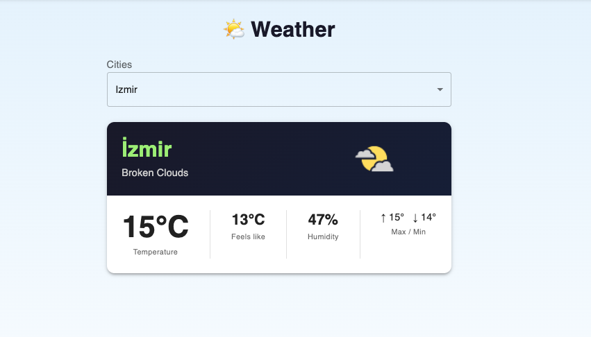
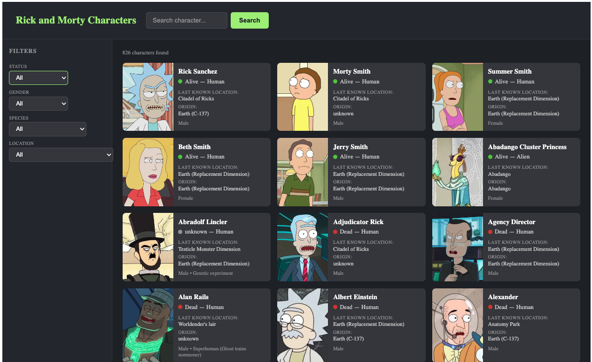
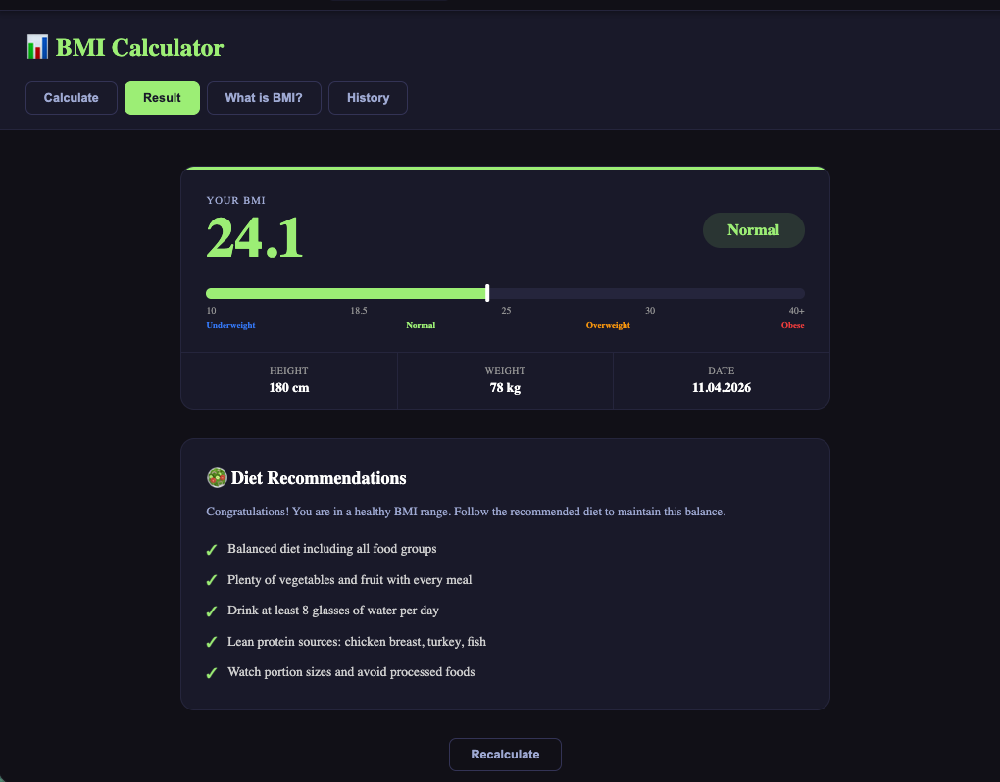
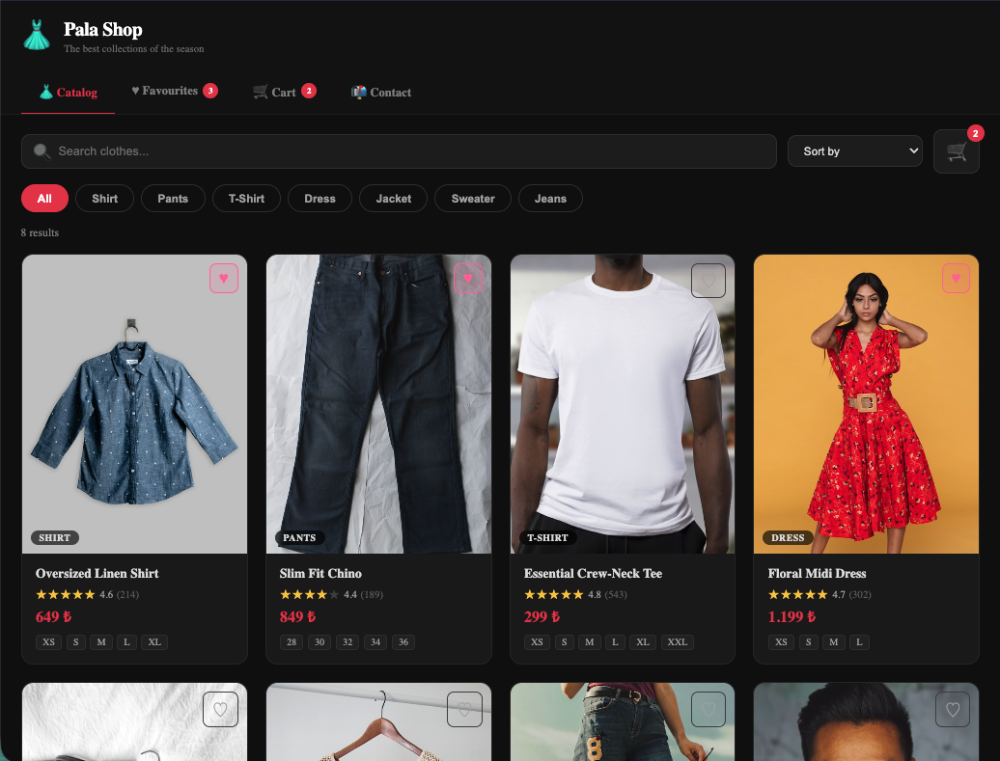
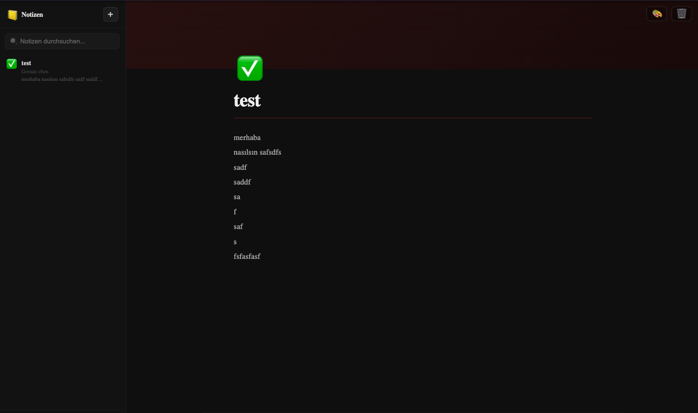
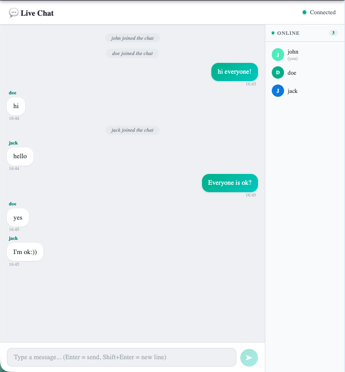
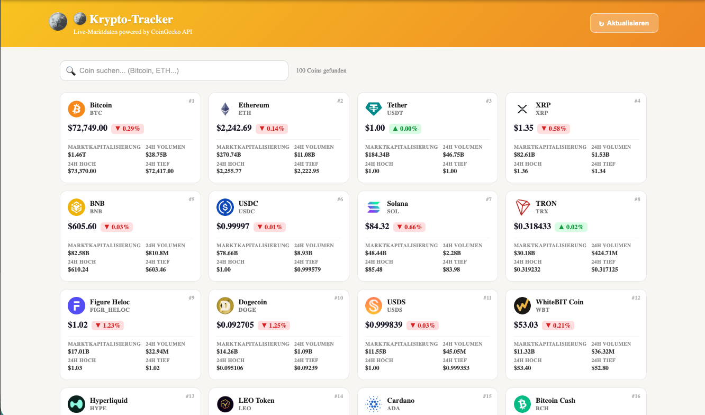
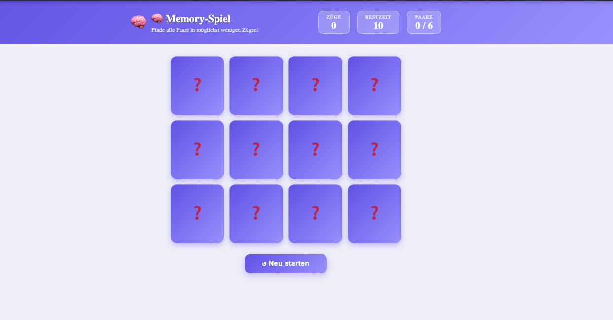
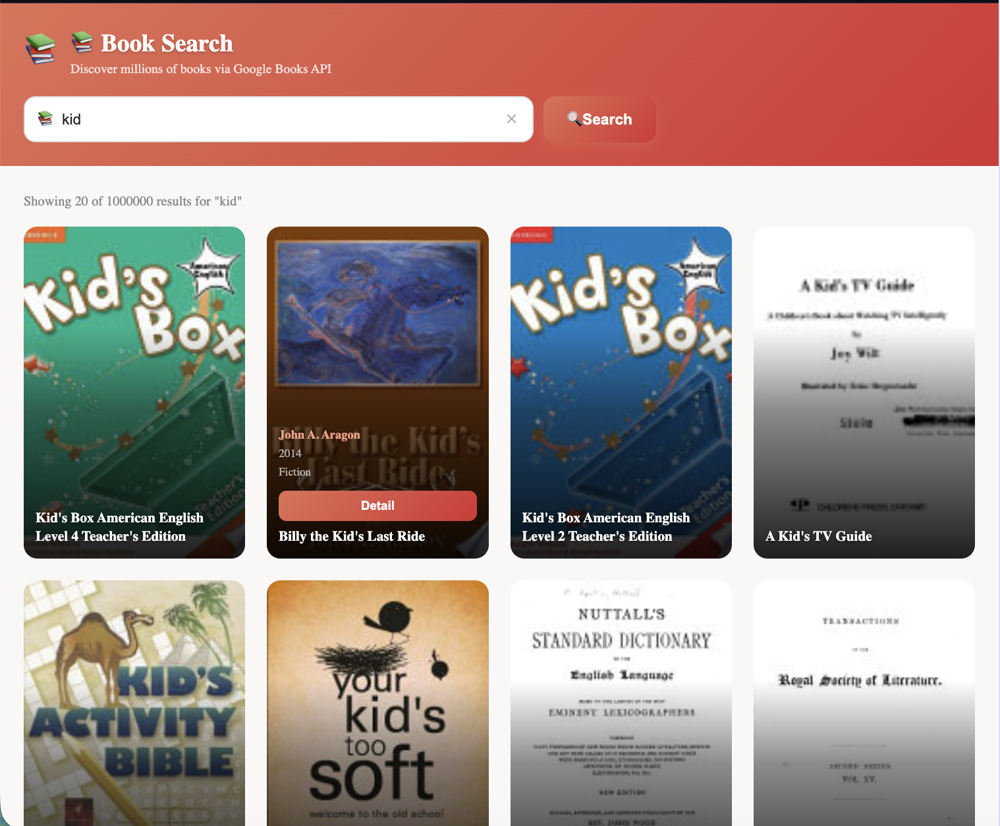

# 🚀 Patika React Apps

> Patika.dev Front-End bootcamp kapsamında geliştirilen **9 React uygulamasının** bir arada bulunduğu monorepo.  
> React 18 · TypeScript (strict) · React Router v7 · CSS Modules · react-i18next (TR / EN / DE)

<p align="center">
  
</p>

---

## 📋 İçindekiler

- [Uygulamalar](#-uygulamalar)
- [Mimari](#-mimari)
- [Teknoloji Yığını](#-teknoloji-yığını)
- [Kurulum](#-kurulum--çalıştırma)
- [Çok Dil Desteği](#-çok-dil-desteği)
- [Proje Yapısı](#-proje-yapısı)

---

## 📦 Uygulamalar

### 01 · 🌤 Weather App — `/weather`

Türkiye'deki 81 şehir için **OpenWeatherMap API** ile anlık hava durumu, sıcaklık, nem ve hissedilen sıcaklık bilgisi.

<p align="center">
  
</p>

**Teknolojiler:** OpenWeatherMap API · React Context · MUI v5

---

### 02 · 🧪 Rick & Morty — `/rickmorty`

Tüm Rick and Morty karakterleri; **GraphQL + Apollo Client** ile listeleme, isim/durum/tür/cinsiyet filtreleme ve sayfalama.

<p align="center">
  
</p>

**Teknolojiler:** GraphQL · Apollo Client v4 · Sayfalama

---

### 03 · 📊 BMI Hesapla — `/bmi`

Vücut kitle endeksi hesaplama, BMI kategorisi, geçmiş kayıtlar ve kişiselleştirilmiş diyet önerileri.

<p align="center">
  
</p>

**Teknolojiler:** localStorage · Styled Components · React Router

---

### 04 · 👗 Moda Mağazası — `/shop`

REST API ile ürün listeleme, filtreleme, alışveriş sepeti ve favoriler. Mock backend ile tam e-ticaret deneyimi.

<p align="center">
  
</p>

**Teknolojiler:** Axios · MockAPI.io · Styled Components · localStorage

---

### 05 · 📒 Notlar — `/notes`

Notion tarzı not alma uygulaması; başlık ve içerik düzenleme, not listeleme, silme. Tüm veriler tarayıcıda saklanır.

<p align="center">
  
</p>

**Teknolojiler:** localStorage · React Router · CSS Modules

---

### 06 · 💬 Canlı Sohbet — `/chat`

**Socket.io** ile gerçek zamanlı çok kullanıcılı sohbet odası. Kullanıcı adı seçimi, anlık mesajlaşma.

<p align="center">
  
</p>

**Teknolojiler:** Socket.io · Node.js backend · React Hooks

---

### 07 · 🪙 Kripto Para — `/crypto`

**CoinGecko API** ile anlık kripto para fiyatları, 24 saatlik değişim, işlem hacmi ve arama.

<p align="center">
  
</p>

**Teknolojiler:** CoinGecko API · Axios · React Hooks

---

### 08 · 🧠 Hafıza Oyunu — `/memory`

4×3 kart eşleştirme oyunu. CSS 3D kart çevirme animasyonu, hamle sayacı ve en iyi skor kaydı.

<p align="center">
  
</p>

**Teknolojiler:** localStorage · CSS 3D Flip · Game Logic

---

### 09 · 📚 Kitaplar — `/books`

**Google Books API** ile kitap arama; kapak görseli, yazar, yayın yılı ve detay modal'ı. Hover ile bilgi katmanı.

<p align="center">
  
</p>

**Teknolojiler:** Google Books API · Axios · CSS Modules · Modal

---

## 🏗 Mimari

Tüm uygulamalar **kart tabanlı ana sayfadan** tek tıklamayla açılır. Gezinme çubuğu (navbar) yoktur.

```
Ana Sayfa (/)
  └─ Karta tıkla
       └─ AppShell (← Geri butonu + Dil seçici)
            └─ İlgili uygulama
```

Her uygulama sol üstteki **← geri** butonu ile ana sayfaya döner.

---

## 🛠 Teknoloji Yığını

| Teknoloji         | Sürüm           | Kullanım                     |
| ----------------- | --------------- | ---------------------------- |
| React             | 18              | Uygulama çatısı              |
| TypeScript        | 4.9 (strict)    | Tip güvenliği                |
| React Router      | v7              | Sayfa yönlendirme            |
| Apollo Client     | v4              | GraphQL (Rick & Morty)       |
| MUI               | v5              | WeatherApp UI bileşenleri    |
| Axios             | —               | HTTP istekleri               |
| Socket.io         | —               | Gerçek zamanlı iletişim      |
| Styled Components | —               | BMI + E-commerce stilleri    |
| CSS Modules       | —               | Bileşen bazlı stilendirme    |
| react-i18next     | —               | TR / EN / DE çok dil desteği |
| Create React App  | react-scripts 5 | Build araçları               |

---

## 🚀 Kurulum & Çalıştırma

```bash
# Bağımlılıkları yükle
npm install

# Geliştirme sunucusunu başlat  →  http://localhost:3000
npm start

# Production build
npm run build
```

### Ortam Değişkenleri

`.env` dosyası oluşturup aşağıdaki anahtarları ekle:

```env
REACT_APP_WEATHER_API_KEY=your_openweathermap_key
REACT_APP_COINGECKO_KEY=your_coingecko_key
REACT_APP_SOCKET_URL=http://localhost:3001
```

### Chat Sunucusunu Başlatma

```bash
cd server
npm install
node index.js   # http://localhost:3001
```

---

## 🌍 Çok Dil Desteği

Tüm uygulamalar **Türkçe**, **İngilizce** ve **Almanca** dillerini destekler.  
Varsayılan dil **Almanca**'dır. Ana sayfanın sağ üstündeki veya uygulama içi üst barda bulunan dil seçici ile değiştirebilirsiniz.

| Dil                     | Kod  |
| ----------------------- | ---- |
| 🇩🇪 Almanca (varsayılan) | `de` |
| 🇬🇧 İngilizce            | `en` |
| 🇹🇷 Türkçe               | `tr` |

---

## 📁 Proje Yapısı

```
src/
├── App.tsx                     # Router — AppShell ile sarılı rotalar
├── components/
│   ├── AppShell.tsx            # Geri butonu + dil seçici (tüm app'lerde)
│   └── LanguageSwitcher.tsx    # TR / EN / DE seçici
├── i18n/
│   └── locales/
│       ├── tr.json
│       ├── en.json
│       └── de.json
├── pages/
│   └── Home.tsx                # Ana sayfa — uygulama kartları
└── apps/
    ├── weatherapp/             # 🌤 Hava durumu
    ├── rickandmorty/           # 🧪 Rick & Morty
    ├── bmi/                    # 📊 BMI hesaplama
    ├── ecommerce/              # 👗 Moda mağazası
    ├── notes/                  # 📒 Notlar
    ├── chat/                   # 💬 Canlı sohbet
    ├── crypto/                 # 🪙 Kripto para takibi
    ├── memory/                 # 🧠 Hafıza oyunu
    └── books/                  # 📚 Kitap arama
server/
└── index.js                    # Socket.io backend (Chat için)
docs/
├── preview.png
├── weather-preview.png
├── rickmorty-preview.png
├── bmi-preview.png
├── ecommerce-preview.png
├── notes-preview.png
├── chat-preview.png
├── crypto-preview.png
├── memory-preview.png
└── book-preview.png
```

---

## 📄 Lisans

MIT © [Mr-Mesut-OZTURK](https://github.com/Mr-Mesut-OZTURK)

The page will reload if you make edits.\
You will also see any lint errors in the console.

### `yarn test`

Launches the test runner in the interactive watch mode.\
See the section about [running tests](https://facebook.github.io/create-react-app/docs/running-tests) for more information.

### `yarn build`

Builds the app for production to the `build` folder.\
It correctly bundles React in production mode and optimizes the build for the best performance.

The build is minified and the filenames include the hashes.\
Your app is ready to be deployed!

See the section about [deployment](https://facebook.github.io/create-react-app/docs/deployment) for more information.

### `yarn eject`

**Note: this is a one-way operation. Once you `eject`, you can’t go back!**

If you aren’t satisfied with the build tool and configuration choices, you can `eject` at any time. This command will remove the single build dependency from your project.

Instead, it will copy all the configuration files and the transitive dependencies (webpack, Babel, ESLint, etc) right into your project so you have full control over them. All of the commands except `eject` will still work, but they will point to the copied scripts so you can tweak them. At this point you’re on your own.

You don’t have to ever use `eject`. The curated feature set is suitable for small and middle deployments, and you shouldn’t feel obligated to use this feature. However we understand that this tool wouldn’t be useful if you couldn’t customize it when you are ready for it.

## Learn More

You can learn more in the [Create React App documentation](https://facebook.github.io/create-react-app/docs/getting-started).

To learn React, check out the [React documentation](https://reactjs.org/).

### Code Splitting

This section has moved here: [https://facebook.github.io/create-react-app/docs/code-splitting](https://facebook.github.io/create-react-app/docs/code-splitting)

### Analyzing the Bundle Size

This section has moved here: [https://facebook.github.io/create-react-app/docs/analyzing-the-bundle-size](https://facebook.github.io/create-react-app/docs/analyzing-the-bundle-size)

### Making a Progressive Web App

This section has moved here: [https://facebook.github.io/create-react-app/docs/making-a-progressive-web-app](https://facebook.github.io/create-react-app/docs/making-a-progressive-web-app)

### Advanced Configuration

This section has moved here: [https://facebook.github.io/create-react-app/docs/advanced-configuration](https://facebook.github.io/create-react-app/docs/advanced-configuration)

### Deployment

This section has moved here: [https://facebook.github.io/create-react-app/docs/deployment](https://facebook.github.io/create-react-app/docs/deployment)

### `yarn build` fails to minify

This section has moved here: [https://facebook.github.io/create-react-app/docs/troubleshooting#npm-run-build-fails-to-minify](https://facebook.github.io/create-react-app/docs/troubleshooting#npm-run-build-fails-to-minify)
