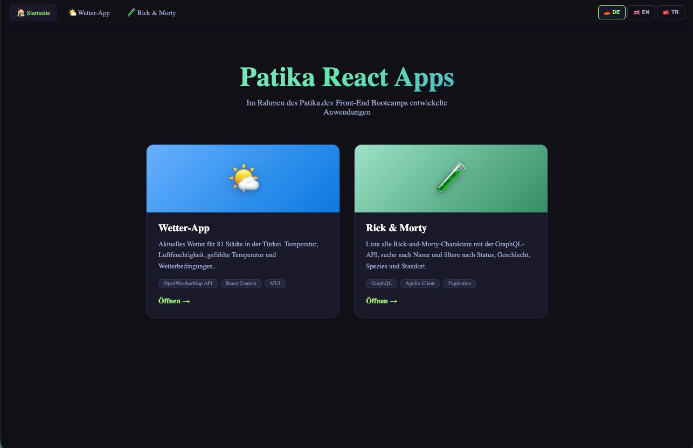

# Patika React Apps

> Patika.dev Front-End bootcamp kapsamında geliştirilen React uygulamalarının bir arada bulunduğu monorepo.



---

## 📦 Uygulamalar

| No  | Uygulama                                             | Yol          | Açıklama                                        | Teknolojiler                                  |
| --- | ---------------------------------------------------- | ------------ | ----------------------------------------------- | --------------------------------------------- |
| 01  | 🌤 [Weather App](./src/apps/weatherapp/README.md)    | `/weather`   | Türkiye'deki 81 şehir için anlık hava durumu    | OpenWeatherMap API, React Context, MUI        |
| 02  | 🧪 [Rick & Morty](./src/apps/rickandmorty/README.md) | `/rickmorty` | Karakter listeleme, arama, çoklu filtreleme     | GraphQL, Apollo Client, Pagination            |
| 03  | 📊 [BMI Hesapla](./src/apps/bmi/README.md)           | `/bmi`       | Vücut kitle endeksi hesaplama + diyet önerileri | localStorage, Styled Components, React Router |
| 04  | 👗 [Moda Mağazası](./src/apps/ecommerce/README.md)   | `/shop`      | Ürün listeleme, sepet, favoriler                | Axios, MockAPI.io, Styled Components          |
| 05  | 📒 [Notlar](./src/apps/notes/README.md)              | `/notes`     | Notion tarzı not uygulaması                     | localStorage, React Router                    |
| 06  | 💬 [Canlı Sohbet](./src/apps/chat/README.md)         | `/chat`      | Gerçek zamanlı çok kullanıcılı sohbet           | Socket.io, Node.js backend                    |
| 07  | 🪙 [Kripto Para](./src/apps/crypto/README.md)        | `/crypto`    | Anlık kripto fiyat takibi, arama                | CoinGecko API, Axios, React Hooks             |

---

## 🛠 Teknoloji Yığını

| Teknoloji                          | Kullanım                            |
| ---------------------------------- | ----------------------------------- |
| React 18 + TypeScript (strict)     | Uygulama çatısı                     |
| React Router v7                    | Uygulamalar arası gezinme           |
| Apollo Client v4                   | GraphQL (Rick & Morty)              |
| MUI v5                             | WeatherApp UI bileşenleri           |
| Axios                              | HTTP istekleri (E-commerce, Crypto) |
| Socket.io                          | Gerçek zamanlı iletişim (Chat)      |
| Styled Components                  | BMI + E-commerce stilleri           |
| CSS Modules                        | Bileşen bazlı stilendirme           |
| react-i18next                      | TR / EN / DE çok dil desteği        |
| Create React App (react-scripts 5) | Build araçları                      |

---

## 🚀 Kurulum & Çalıştırma

```bash
# Bağımlılıkları yükle
npm install

# Geliştirme sunucusunu başlat (http://localhost:3000)
npm start

# Production build
npm run build
```

### Ortam Değişkenleri

`.env` dosyası oluştur ve aşağıdaki anahtarları ekle:

```env
REACT_APP_WEATHER_API_KEY=your_openweathermap_key
REACT_APP_COINGECKO_KEY=your_coingecko_key
REACT_APP_SOCKET_URL=http://localhost:3001
```

### Chat Sunucusunu Başlatma

```bash
cd server
npm install
node index.js
# Sunucu http://localhost:3001 adresinde çalışır
```

---

## 📁 Proje Yapısı

```
src/
├── App.tsx                  # Router + navbar
├── index.tsx
├── i18n/
│   └── locales/
│       ├── tr.json          # Türkçe
│       ├── en.json          # İngilizce
│       └── de.json          # Almanca
├── pages/
│   └── Home.tsx             # Ana sayfa — uygulama kartları
└── apps/
    ├── weatherapp/          # 🌤 Hava durumu
    ├── rickandmorty/        # 🧪 Rick & Morty
    ├── bmi/                 # 📊 BMI hesaplama
    ├── ecommerce/           # 👗 Moda mağazası
    ├── notes/               # 📒 Notlar
    ├── chat/                # 💬 Canlı sohbet
    └── crypto/              # 🪙 Kripto para takibi
server/
└── index.js                 # Socket.io backend (Chat için)
```

---

## 🌍 Çok Dil Desteği

Tüm uygulamalar **Türkçe**, **İngilizce** ve **Almanca** dillerini destekler.  
Varsayılan dil **Almanca**'dır. Sağ üstteki dil seçici ile değiştirebilirsiniz.

---

## 🌐 Netlify Deploy

```bash
npm run build
# build/ klasörünü Netlify'a deploy et
```

Netlify > Site settings > Environment variables bölümüne `.env` değişkenlerini eklemeyi unutmayın.

---

## Lisans

MIT

In the project directory, you can run:

### `yarn start`

Runs the app in the development mode.\
Open [http://localhost:3000](http://localhost:3000) to view it in the browser.

The page will reload if you make edits.\
You will also see any lint errors in the console.

### `yarn test`

Launches the test runner in the interactive watch mode.\
See the section about [running tests](https://facebook.github.io/create-react-app/docs/running-tests) for more information.

### `yarn build`

Builds the app for production to the `build` folder.\
It correctly bundles React in production mode and optimizes the build for the best performance.

The build is minified and the filenames include the hashes.\
Your app is ready to be deployed!

See the section about [deployment](https://facebook.github.io/create-react-app/docs/deployment) for more information.

### `yarn eject`

**Note: this is a one-way operation. Once you `eject`, you can’t go back!**

If you aren’t satisfied with the build tool and configuration choices, you can `eject` at any time. This command will remove the single build dependency from your project.

Instead, it will copy all the configuration files and the transitive dependencies (webpack, Babel, ESLint, etc) right into your project so you have full control over them. All of the commands except `eject` will still work, but they will point to the copied scripts so you can tweak them. At this point you’re on your own.

You don’t have to ever use `eject`. The curated feature set is suitable for small and middle deployments, and you shouldn’t feel obligated to use this feature. However we understand that this tool wouldn’t be useful if you couldn’t customize it when you are ready for it.

## Learn More

You can learn more in the [Create React App documentation](https://facebook.github.io/create-react-app/docs/getting-started).

To learn React, check out the [React documentation](https://reactjs.org/).

### Code Splitting

This section has moved here: [https://facebook.github.io/create-react-app/docs/code-splitting](https://facebook.github.io/create-react-app/docs/code-splitting)

### Analyzing the Bundle Size

This section has moved here: [https://facebook.github.io/create-react-app/docs/analyzing-the-bundle-size](https://facebook.github.io/create-react-app/docs/analyzing-the-bundle-size)

### Making a Progressive Web App

This section has moved here: [https://facebook.github.io/create-react-app/docs/making-a-progressive-web-app](https://facebook.github.io/create-react-app/docs/making-a-progressive-web-app)

### Advanced Configuration

This section has moved here: [https://facebook.github.io/create-react-app/docs/advanced-configuration](https://facebook.github.io/create-react-app/docs/advanced-configuration)

### Deployment

This section has moved here: [https://facebook.github.io/create-react-app/docs/deployment](https://facebook.github.io/create-react-app/docs/deployment)

### `yarn build` fails to minify

This section has moved here: [https://facebook.github.io/create-react-app/docs/troubleshooting#npm-run-build-fails-to-minify](https://facebook.github.io/create-react-app/docs/troubleshooting#npm-run-build-fails-to-minify)
