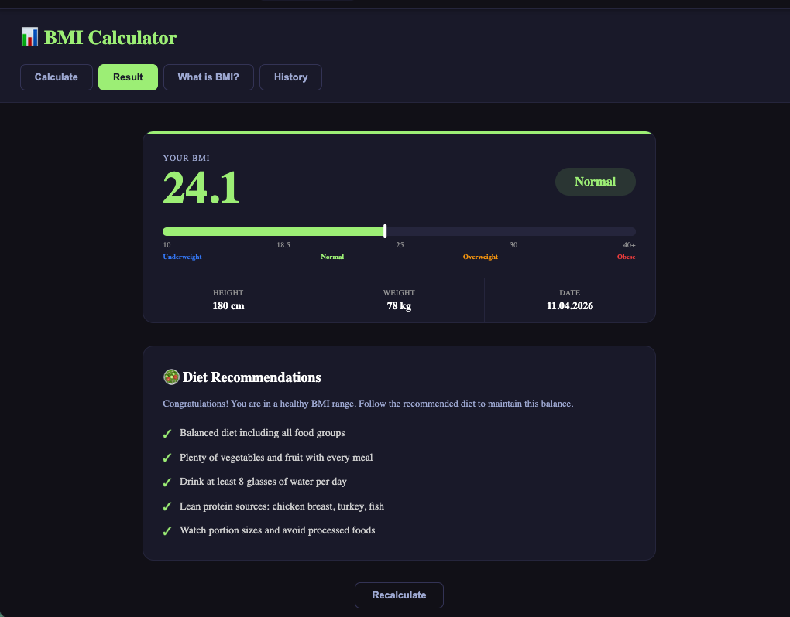

# 📊 BMI Hesaplama Uygulaması

Boy ve kilo girişiyle Vücut Kitle Endeksini (BMI) hesaplayan, kategoriye özel diyet önerileri sunan ve hesaplama geçmişini tutan React uygulaması.



---

## Özellikler

| Özellik            | Açıklama                                                                 |
| ------------------ | ------------------------------------------------------------------------ |
| 🧮 BMI Hesaplama   | Boy (cm) ve kilo (kg) girilince BMI değeri ve kategorisi hesaplanır      |
| 📊 Sonuç Sayfası   | Renkli gauge çubuğu, skor ve kategori badge'iyle görsel sunum            |
| 🥗 Diyet Önerileri | Zayıf, normal, fazla kilolu ve obez kategorisine özel 5 maddelik liste   |
| ℹ️ BMI Nedir?      | Formül, aralık tablosu ve bilgilendirme sayfası                          |
| 🕓 Geçmiş          | Son 20 hesaplama localStorage'da saklanır, güncellenir ve temizlenebilir |
| 🌍 Çok Dil         | Türkçe, İngilizce ve Almanca desteği                                     |
| 📱 Responsive      | Mobil için optimize edilmiş düzen                                        |

---

## Kullanılan Teknolojiler

| Teknoloji         | Versiyon |
| ----------------- | -------- |
| React             | 18       |
| TypeScript        | 4+       |
| React Router      | 7        |
| Styled Components | 6        |
| react-i18next     | 14       |
| CSS Modules       | —        |

---

## URL Yapısı

| Yol            | Sayfa                        |
| -------------- | ---------------------------- |
| `/bmi`         | Hesaplama formu (varsayılan) |
| `/bmi/result`  | Hesaplama sonucu + diyet     |
| `/bmi/info`    | BMI nedir? açıklama sayfası  |
| `/bmi/history` | Geçmiş hesaplamalar          |

---

## localStorage

| Anahtar          | İçerik                                     |
| ---------------- | ------------------------------------------ |
| `bmi_result`     | Son hesaplama sonucu (JSON)                |
| `bmi_last_input` | Son girilen boy/kilo (form ön dolumu için) |
| `bmi_history`    | Son 20 hesaplama listesi (JSON array)      |

---

## Dosya Yapısı

```
bmi/
├── BMIApp.tsx                  # Ana bileşen — tab navigasyonu + nested routes
├── BMIApp.module.css
├── types.ts                    # BMIData, BMICategory tipleri
├── styled/
│   └── Buttons.tsx             # PrimaryButton, SecondaryButton, DangerButton, TabButton
└── components/
    ├── BMICalculator.tsx       # Boy-kilo formu, hesaplama, localStorage kayıt
    ├── BMICalculator.module.css
    ├── BMIResult.tsx           # Skor, gauge, istatistikler, DietList
    ├── BMIResult.module.css
    ├── DietList.tsx            # Kategoriye göre diyet önerileri
    ├── DietList.module.css
    ├── BMIInfo.tsx             # BMI açıklama + aralık tablosu
    ├── BMIInfo.module.css
    ├── BMIHistory.tsx          # localStorage'dan geçmiş hesaplamalar
    └── BMIHistory.module.css
```

---

## BMI Kategorileri

| Kategori     | BMI Aralığı |
| ------------ | ----------- |
| Zayıf        | < 18.5      |
| Normal       | 18.5 – 24.9 |
| Fazla Kilolu | 25 – 29.9   |
| Obez         | ≥ 30        |
