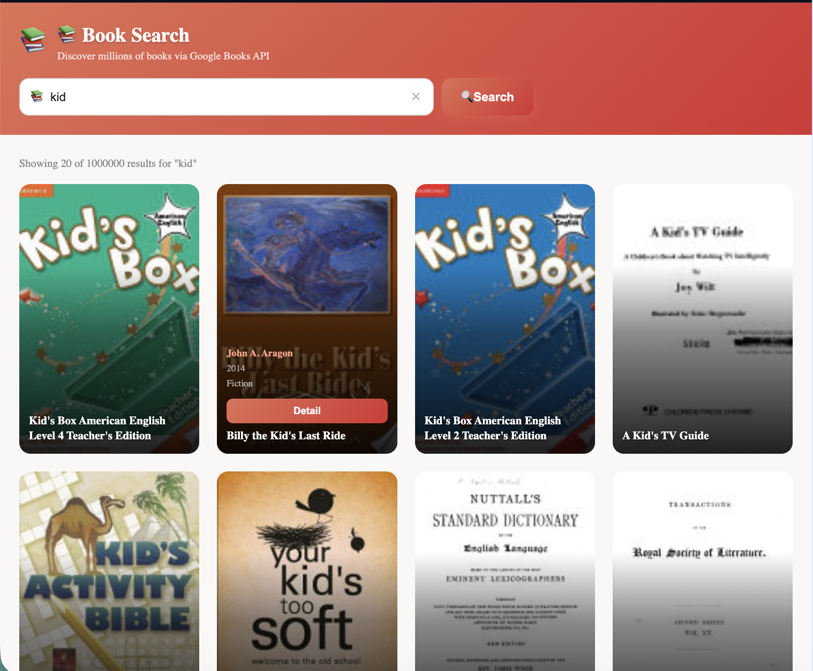

# 📚 Books App

Google Books API ile milyonlarca kitap arasında arama yapabileceğiniz uygulama.  
Kitap kapakları önde, hover ile detaylar belirir, tıklayınca tam bilgi modalı açılır.

<p align="center">
  
</p>

---

## ✨ Özellikler

- 🔍 **Arama** — Form submit ile Google Books API'ye istek atılır (her tuş vuruşunda değil)
- 🖼 **Kapak odaklı grid** — Kartlar yalnızca kitap kapağı + isim gösterir
- 🎨 **Hover overlay** — Üzerine gelince yazar, yıl, kategori ve Detay butonu yukarı kayar
- 📖 **Detay modalı** — Açıklama, sayfa sayısı, ortalama puan, dil, yayınevi, önizleme linki
- ⚡ **Loading skeleton** — Arama sırasında shimmer animasyonlu placeholder kartlar
- ❌ **Hata yönetimi** — Rate limit ve ağ hatası için ayrı mesajlar
- 🌍 **Çok dil** — Türkçe / İngilizce / Almanca (react-i18next)

---

## 🗂 Dosya Yapısı

```
src/apps/books/
├── BooksApp.tsx              # Ana sayfa — arama formu + grid
├── BooksApp.module.css
├── types.ts                  # BookVolume, GoogleBooksResponse arayüzleri
├── hooks/
│   └── useBookSearch.ts      # Arama state + Axios isteği
└── components/
    ├── SearchForm.tsx         # Kontrollü input, submit tetikler
    ├── SearchForm.module.css
    ├── BookCard.tsx           # Kapak kartı — hover overlay
    ├── BookCard.module.css
    ├── BookModal.tsx          # Detay modalı (Escape / dışarı tıkla ile kapanır)
    └── BookModal.module.css
```

---

## 🔌 API

**Google Books Volumes API** — ücretsiz, API anahtarı gerekmez (temel arama için).

```
GET https://www.googleapis.com/books/v1/volumes
  ?q=<sorgu>
  &maxResults=20
  &printType=books
```

### Yanıt Alanları

| Alan                                      | Tür        | Açıklama                    |
| ----------------------------------------- | ---------- | --------------------------- |
| `totalItems`                              | `number`   | Toplam sonuç sayısı         |
| `items[].id`                              | `string`   | Benzersiz kitap ID'si       |
| `items[].volumeInfo.title`                | `string`   | Kitap adı                   |
| `items[].volumeInfo.authors`              | `string[]` | Yazar(lar)                  |
| `items[].volumeInfo.publishedDate`        | `string`   | Yayın tarihi                |
| `items[].volumeInfo.description`          | `string`   | Açıklama                    |
| `items[].volumeInfo.pageCount`            | `number`   | Sayfa sayısı                |
| `items[].volumeInfo.categories`           | `string[]` | Kategoriler                 |
| `items[].volumeInfo.averageRating`        | `number`   | Ortalama puan               |
| `items[].volumeInfo.imageLinks.thumbnail` | `string`   | Kapak görseli               |
| `items[].volumeInfo.previewLink`          | `string`   | Google Books önizleme linki |

---

## 🧩 Bileşenler

### `useBookSearch` (hook)

```ts
const { books, loading, error, totalItems, lastQuery, search, clear } =
  useBookSearch();
```

| Değer        | Tür              | Açıklama                            |
| ------------ | ---------------- | ----------------------------------- |
| `books`      | `BookVolume[]`   | Sonuç listesi                       |
| `loading`    | `boolean`        | İstek devam ediyor mu               |
| `error`      | `string \| null` | `"rate_limit"` veya `"fetch_error"` |
| `totalItems` | `number`         | API toplam sonuç sayısı             |
| `lastQuery`  | `string`         | Son aranan kelime                   |
| `search(q)`  | `function`       | Arama başlatır                      |
| `clear()`    | `function`       | Durumu sıfırlar                     |

### `SearchForm`

Kontrollü `<input>`. Form submit edildiğinde `onSearch(query)` çağrılır.  
Arama sırasında buton spinner gösterir ve devre dışı kalır.

### `BookCard`

- Varsayılan: yalnızca kapak görseli + altta kitap adı (overlay gradient)
- Hover: yazar, yıl, kategori ve **Detay** butonu yukarı kayarak belirir
- Kapak yoksa SVG placeholder gösterilir

### `BookModal`

- `selectedBook` prop'u dolu olduğunda render edilir
- Kapatma: **Escape** tuşu, backdrop tıklaması veya ✕ butonu
- İçerik: açıklama, yazar, yayınevi, tarih, sayfa sayısı, dil, puan, kategoriler
- Google Books önizleme linki

---

## 🌍 i18n Anahtarları

```json
{
  "books.title": "Kitap Ara",
  "books.subtitle": "Google Books API ile milyonlarca kitap",
  "books.placeholder": "Kitap adı, yazar veya konu...",
  "books.search": "Ara",
  "books.searching": "Aranıyor...",
  "books.clear": "Temizle",
  "books.results": "{{count}} sonuçtan 20 tanesi gösteriliyor: \"{{query}}\"",
  "books.detail": "Detay",
  "books.unknown_author": "Bilinmeyen Yazar",
  "books.no_description": "Açıklama bulunmuyor.",
  "books.preview": "Google Books'ta Aç",
  "books.error_rate": "Çok fazla istek gönderildi, lütfen bekleyin.",
  "books.error_fetch": "Kitaplar yüklenemedi. İnternet bağlantınızı kontrol edin.",
  "books.idle_title": "Ne okumak istersiniz?",
  "books.idle_sub": "Yukarıdaki arama kutusuna bir kitap adı veya yazar yazın.",
  "books.modal_close": "Kapat"
}
```

---

## 📄 Lisans

MIT
