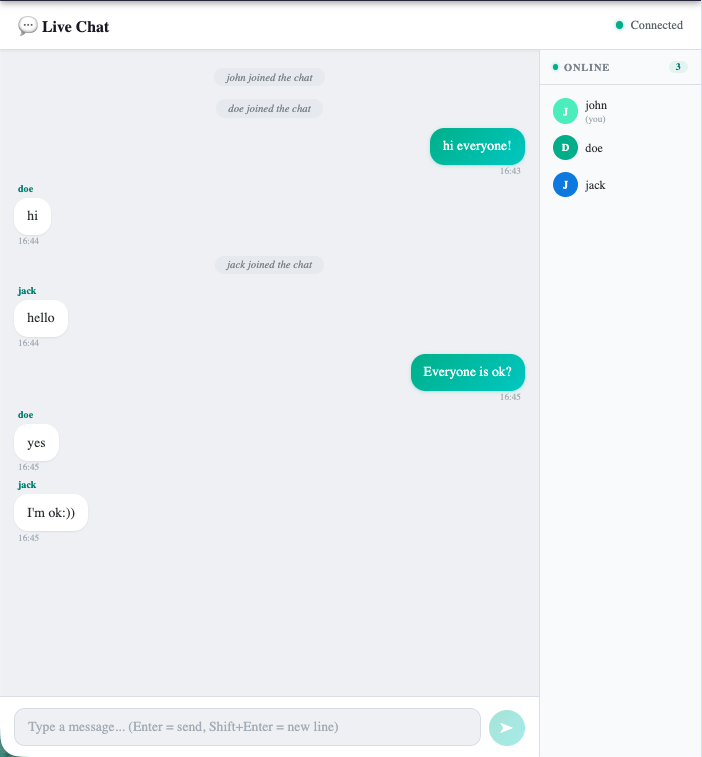

# 💬 Chat Uygulaması

Gerçek zamanlı çok kullanıcılı sohbet uygulaması. React frontend + Node.js/Socket.io backend.



---

## Özellikler

- **Gerçek zamanlı mesajlaşma** — Socket.io ile anında iletişim
- **Kullanıcı adı girişi** — Sohbete katılmadan önce ad seçimi
- **Çevrimiçi kullanıcı paneli** — Sağ sidebar'da renk kodlu avatar listesi
- **Katılma / Ayrılma bildirimleri** — Sistem mesajları
- **Yazma göstergesi** — "Kullanıcı yazıyor..." gösterimi
- **Sayfa yenileme = sıfırlama** — Mesajlar tarayıcıda saklanmaz
- **Bağlantı uyarısı** — Sunucu kapalıyken sarı banner gösterir
- **Çok dilli** — TR / EN / DE desteği
- **Responsive** — Mobil uyumlu açık tema (UserPanel mobilde gizlenir)

## Mimari

```
patika-react-apps/
├── server/                    # Node.js + Socket.io backend
│   ├── index.js               # Express HTTP sunucusu + Socket.io
│   ├── package.json
│   └── .gitignore
└── src/apps/chat/
    ├── ChatApp.tsx            # Ana layout bileşeni
    ├── ChatApp.module.css
    ├── types.ts               # TypeScript arayüzleri
    ├── hooks/
    │   └── useSocket.ts       # Socket.io bağlantı hook'u
    └── components/
        ├── JoinScreen.tsx         # Kullanıcı adı giriş ekranı
        ├── JoinScreen.module.css
        ├── MessageList.tsx        # Mesaj listesi (scroll alanı)
        ├── MessageList.module.css
        ├── MessageInput.tsx       # Mesaj yazma + gönder butonu
        ├── MessageInput.module.css
        ├── UserPanel.tsx          # Çevrimiçi kullanıcı sidebar'ı
        └── UserPanel.module.css
```

## Socket.io Olayları

| Yön             | Olay          | Veri                                   |
| --------------- | ------------- | -------------------------------------- |
| Client → Server | `join`        | `{ username }`                         |
| Client → Server | `message`     | `{ text }`                             |
| Client → Server | `typing`      | —                                      |
| Client → Server | `stop_typing` | —                                      |
| Server → Client | `message`     | `{ id, username, socketId, text, at }` |
| Server → Client | `user_joined` | `{ username, at }`                     |
| Server → Client | `user_left`   | `{ username, at }`                     |
| Server → Client | `user_list`   | `{ socketId, username }[]`             |
| Server → Client | `typing`      | `{ username }`                         |
| Server → Client | `stop_typing` | `{ username }`                         |

## TypeScript Tipleri

```ts
interface ChatMessage {
  id: string;
  type: "message";
  username: string;
  socketId: string;
  text: string;
  at: number;
}

interface SystemMessage {
  id: string;
  type: "join" | "leave";
  username: string;
  at: number;
}

type AnyMessage = ChatMessage | SystemMessage;

interface ChatUser {
  socketId: string;
  username: string;
}
```

## Kurulum ve Çalıştırma

### Lokal Geliştirme

**1. Backend'i başlat:**

```bash
cd server
npm install
npm run dev   # nodemon ile hot-reload
```

**2. Frontend'i başlat (ayrı terminal):**

```bash
# Proje kök dizininde
npm run dev
```

Uygulama → `http://localhost:3000/chat`  
Backend → `http://localhost:3001`

### Ortam Değişkenleri

Proje kökündeki `.env` dosyasında:

```
REACT_APP_SOCKET_URL=http://localhost:3001
```

## Deploy (Üretim Ortamı)

### Backend → Render.com (Ücretsiz)

1. [render.com](https://render.com)'a git → **New Web Service**
2. GitHub reposunu bağla
3. **Root Directory**: `server`
4. **Build Command**: `npm install`
5. **Start Command**: `node index.js`
6. Ortam değişkeni ekle: `FRONTEND_URL=https://your-app.netlify.app`
7. Verilen servis URL'sini kopyala (örn. `https://patika-chat.onrender.com`)

### Frontend → Netlify

1. `npm run build` ile production build al
2. Netlify'a yükle (drag & drop veya GitHub bağlantısı)
3. **Site configuration → Environment variables** bölümüne ekle:
   - `REACT_APP_SOCKET_URL=https://patika-chat.onrender.com`
4. Redeploy et

> `FRONTEND_URL` neden gerekli? Sunucudaki CORS politikası yalnızca bu URL'den gelen bağlantılara izin verir. Tanımlanmazsa geliştirme ortamında `*` (herkese açık) kullanılır.

## Teknik Detaylar

| Katman           | Teknoloji                                              |
| ---------------- | ------------------------------------------------------ |
| Frontend         | React 18 + TypeScript + CSS Modules                    |
| Backend          | Node.js + Express 4 + Socket.io v4 + cors              |
| Durum yönetimi   | `useState` + `useEffect` + custom `useSocket` hook     |
| Kullanıcı takibi | Sunucu tarafı `Map<socketId, username>`                |
| Mesaj kalıcılığı | Yok — sayfa yenilenince sıfırlanır                     |
| Tip güvenliği    | `AnyMessage = ChatMessage \| SystemMessage` union type |
