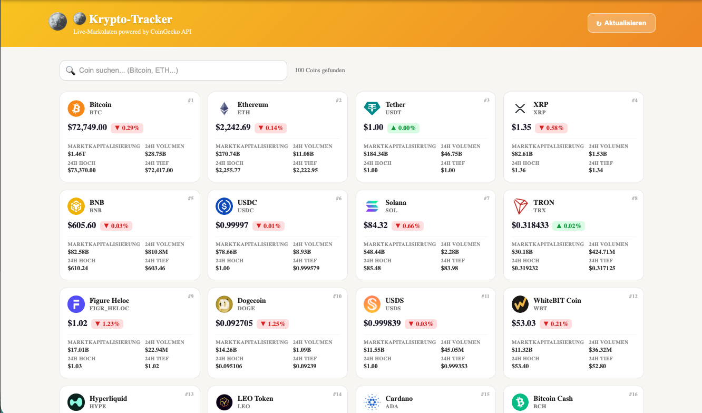

# 🪙 Kripto Para Takip / Crypto Tracker

> **Live demo:** [Netlify deploy link](https://patika-react-apps.netlify.app/crypto)



---

## 📌 Proje Hakkında / About

**TR:** CoinGecko API kullanılarak geliştirilen gerçek zamanlı kripto para fiyat takip uygulaması. İlk 100 coin piyasa değerine göre sıralanır. Ada veya sembolüne göre anlık arama yapılabilir.

**EN:** A live cryptocurrency price tracker built with the CoinGecko API. Displays the top 100 coins sorted by market cap with real-time search by name or symbol.

---

## 🛠 Teknolojiler / Tech Stack

| Teknoloji                | Kullanım                            |
| ------------------------ | ----------------------------------- |
| React 18 + TypeScript    | Uygulama çatısı                     |
| Axios                    | CoinGecko API istekleri             |
| `useEffect` + `useState` | Veri çekme ve durum yönetimi        |
| `Array.map()`            | Coin kartlarını dinamik render      |
| CSS Modules              | Bileşen bazlı stil                  |
| react-i18next            | TR / EN / DE dil desteği            |
| `Intl.NumberFormat`      | Para birimi ve kompakt sayı formatı |

---

## ✨ Özellikler / Features

- 🔴 **Canlı Fiyatlar** — Sayfa yenilendiğinde CoinGecko'dan güncel veri çeker
- 🔍 **Anlık Arama** — Ada veya sembol ile 100 coin içinde istemci tarafı filtreleme
- 📈 **24 Saatlik Değişim** — Yüzde değişim renk kodlu (yeşil ▲ / kırmızı ▼)
- 💰 **Piyasa Verisi** — Market cap, hacim, 24s en yüksek/düşük
- ↻ **Manuel Yenileme** — Header'daki buton ile istediğinde yenile
- ⚠️ **Hata Yönetimi** — Rate limit ve ağ hatası için ayrı mesajlar + retry
- ⏳ **Yükleme İskeleti** — Shimmer animasyonlu skeleton kartlar
- 📱 **Responsive Tasarım** — Mobil/tablet/masaüstü desteği
- 🌐 **Çok Dilli** — Türkçe, İngilizce, Almanca

---

## 🗂 Dosya Yapısı / File Structure

```
src/apps/crypto/
├── CryptoApp.tsx          # Ana bileşen — layout, loading/error state
├── CryptoApp.module.css   # Ana sayfa stilleri
├── types.ts               # Coin arayüzü (TypeScript)
├── hooks/
│   └── useCryptoList.ts   # Veri çekme hook'u — axios, arama, state
└── components/
    ├── SearchBar.tsx       # Arama girişi + temizle butonu
    ├── SearchBar.module.css
    ├── CoinCard.tsx        # Tek coin kartı — fiyat, değişim, istatistikler
    └── CoinCard.module.css
```

---

## 🔑 API Anahtarı / API Key

`.env` dosyanıza ekleyin / Add to your `.env`:

```
REACT_APP_COINGECKO_KEY=your_key_here
```

CoinGecko Demo API anahtarını [buradan](https://www.coingecko.com/en/api) ücretsiz alabilirsiniz.

---

## 🚀 Çalıştırma / Running Locally

```bash
npm install
npm start
# Open http://localhost:3000/crypto
```

---

## 🌍 Netlify Deploy

```bash
npm run build
# Deploy the build/ folder to Netlify
```

`REACT_APP_COINGECKO_KEY` değişkenini Netlify > Site settings > Environment variables bölümüne eklemeyi unutmayın.
