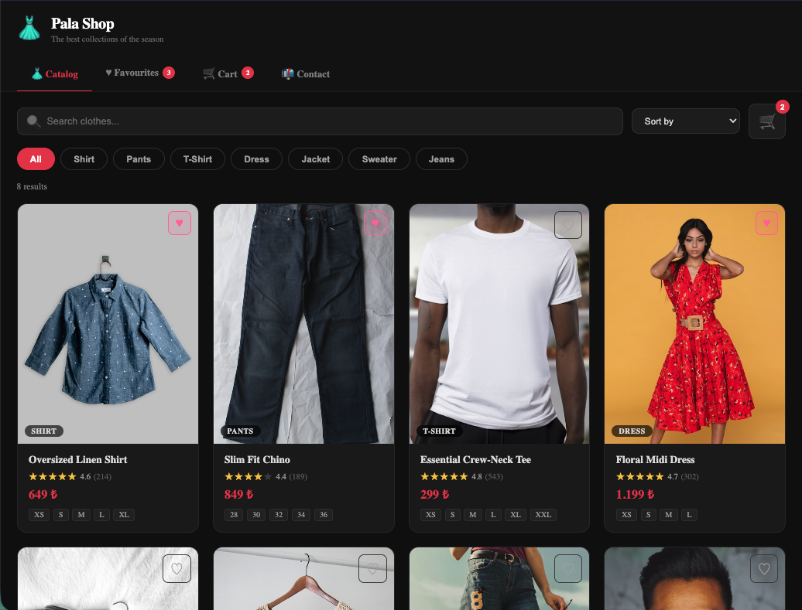

# 👗 Pala Shop — E-Ticaret (Kıyafet) Uygulaması

Kıyafet koleksiyonunu listeleyen, ürün detayı gösteren, sepet ve favoriler yöneten tam özellikli bir React e-ticaret uygulaması.



---

## Özellikler

| Özellik               | Açıklama                                                                                  |
| --------------------- | ----------------------------------------------------------------------------------------- |
| 🛍️ Ürün Kataloğu      | Kategoriye göre filtrele, ada göre ara, fiyat/puan sıralaması ile tüm koleksiyonu listele |
| 🔍 Ürün Detayı        | Beden ve renk seçimi, adet ayarı, sepete / favorilere ekleme                              |
| 🛒 Sepet              | Adet artır/azalt, her satır için ara toplam, sipariş özeti paneli, sepeti boşalt          |
| ♥ Favoriler           | Beğenilen ürünleri localStorage'da sakla, detaya git, favorilerden çıkar                  |
| 📬 İletişim           | Doğrulamalı iletişim formu (ad, e-posta, konu, mesaj) ve başarı bildirimi                 |
| 🌐 Axios + MockAPI.io | Ürünler MockAPI.io'dan axios ile çekilir; URL tanımlı değilse yerel mock veriye düşer     |
| 💾 localStorage       | Sepet (`ec_cart`) ve favoriler (`ec_favorites`) oturum kapansa bile korunur               |
| 🌍 Çok Dil            | Türkçe, İngilizce ve Almanca desteği                                                      |
| 📱 Responsive         | Mobil için optimize edilmiş kart grid, tab navigasyonu ve form düzeni                     |

---

## Kullanılan Teknolojiler

| Teknoloji         | Versiyon | Kullanım Amacı                          |
| ----------------- | -------- | --------------------------------------- |
| React             | 18       | UI                                      |
| TypeScript        | 4+       | Tip güvenliği                           |
| React Router      | 7        | İç içe route yapısı (`/shop/*`)         |
| Axios             | 1+       | MockAPI.io'dan ürün verisi çekme        |
| Styled Components | 6        | Buton bileşenlerinin stili              |
| React Context     | —        | Sepet + favoriler global state yönetimi |
| react-i18next     | 14       | TR / EN / DE çeviri                     |
| CSS Modules       | —        | Bileşen bazlı stil izolasyonu           |

---

## URL Yapısı

| Yol                 | Sayfa                      |
| ------------------- | -------------------------- |
| `/shop`             | Ürün kataloğu (varsayılan) |
| `/shop/product/:id` | Ürün detay sayfası         |
| `/shop/favorites`   | Favoriler                  |
| `/shop/cart`        | Sepet                      |
| `/shop/contact`     | İletişim formu             |

---

## MockAPI.io Kurulumu (Opsiyonel)

1. [mockapi.io](https://mockapi.io) üzerinde ücretsiz proje oluştur.
2. `products` adında bir resource ekle ve aşağıdaki alanları tanımla:

   | Alan          | Tür    |
   | ------------- | ------ |
   | `id`          | String |
   | `name`        | String |
   | `price`       | Number |
   | `category`    | String |
   | `image`       | String |
   | `description` | String |
   | `sizes`       | Array  |
   | `colors`      | Array  |
   | `rating`      | Number |
   | `reviewCount` | Number |

3. Proje kökündeki `.env` dosyasına ekle:

   ```env
   REACT_APP_MOCKAPI_URL=https://YOUR_ID.mockapi.io/api/v1
   ```

> URL tanımlı değilse uygulama `mockData.ts` içindeki 8 yerel ürünü kullanır — MockAPI.io olmadan da tam olarak çalışır.

---

## localStorage

| Anahtar        | İçerik                                   |
| -------------- | ---------------------------------------- |
| `ec_cart`      | Sepet öğeleri JSON dizisi (`CartItem[]`) |
| `ec_favorites` | Favori ürünler JSON dizisi (`Product[]`) |

---

## Dosya Yapısı

```
ecommerce/
├── EcommerceApp.tsx              # Ana bileşen — ShopProvider, sticky header, tab nav, nested Routes
├── EcommerceApp.module.css
├── types.ts                      # Product, CartItem arayüzleri
├── config.ts                     # MOCKAPI_BASE_URL (.env'den)
├── mockData.ts                   # 8 yerel kıyafet ürünü (Unsplash görselleri)
├── contexts/
│   └── ShopContext.tsx           # Sepet + favoriler state, localStorage sync, useShop() hook
├── hooks/
│   └── useProducts.ts            # Axios fetch (MockAPI) + mock veriye fallback
├── styled/
│   └── Buttons.tsx               # PrimaryButton, SecondaryButton, FavoriteButton, DangerButton, FilterButton, IconButton
└── components/
    ├── ProductCatalog.tsx         # Ürün grid, arama, kategori filtresi, sıralama
    ├── ProductCatalog.module.css
    ├── ProductDetail.tsx          # Beden/renk/adet seçimi, sepet + favori ekleme
    ├── ProductDetail.module.css
    ├── Cart.tsx                   # Sepet listesi, qty kontrolleri, sipariş özeti
    ├── Cart.module.css
    ├── Favorites.tsx              # Favori ürün grid'i
    ├── Favorites.module.css
    ├── Contact.tsx                # Doğrulamalı iletişim formu
    └── Contact.module.css
```
