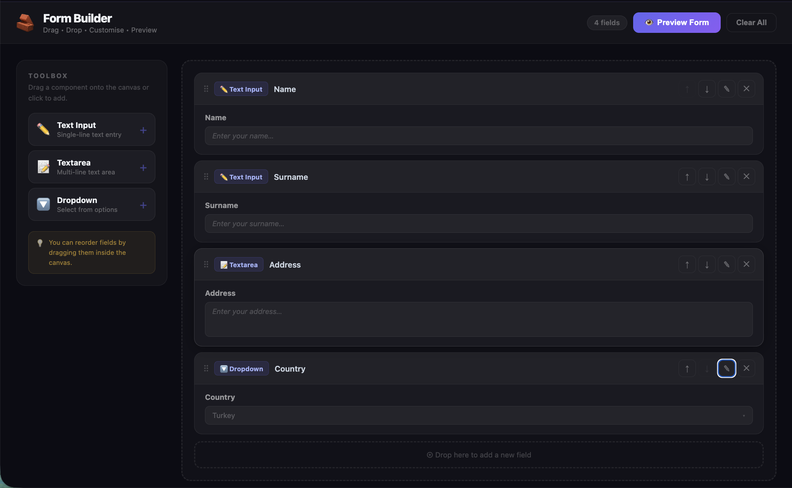

# 🧱 Form Builder

A drag-and-drop form builder with inline field editing, reordering, and a live **Preview Form** modal. Build real HTML forms visually — no code required.



---

## Features

| Feature                      | Details                                                                                                            |
| ---------------------------- | ------------------------------------------------------------------------------------------------------------------ |
| **HTML5 Drag & Drop**        | Drag components from the Toolbox onto the Canvas; drag fields within the canvas to reorder                         |
| **Click to add**             | Click the `+` button on any Toolbox item to append it to the canvas instantly                                      |
| **3 field types**            | ✏️ Text Input (single-line), 📝 Textarea (multi-line), 🔽 Dropdown (select from options)                           |
| **Inline field editing**     | Click the ✎ edit icon on any field to expand an edit panel without leaving the canvas                              |
| **Label & placeholder edit** | Two text inputs let you customise the field's label and placeholder text live                                      |
| **Required toggle**          | A custom pill toggle marks a field as required — shows `*` in the preview form                                     |
| **Dropdown options editor**  | Add/remove individual options for Dropdown fields inline, with per-option delete buttons                           |
| **↑ ↓ reorder buttons**      | One-click arrow buttons to move any field up or down in the list                                                   |
| **Drag-to-reorder**          | Grab the ⠿ drag handle on any field card and drop it to a new position                                             |
| **Delete field**             | ✕ button removes a field immediately                                                                               |
| **Canvas drop zone**         | Dashed bottom drop-zone highlights on hover so you know exactly where a new field will land                        |
| **Preview Form modal**       | Opens a frosted-glass modal rendering the real `<form>` with actual `<input>` / `<textarea>` / `<select>` elements |
| **Clear All**                | Header button resets the canvas to empty state in one click                                                        |
| **Field counter**            | Header badge shows the live count of fields on the canvas                                                          |
| **i18n (TR / EN / DE)**      | All strings fully translated via react-i18next                                                                     |

---

## How to use

1. Navigate to `/formbuilder`
2. **Add fields** — drag a Toolbox item onto the canvas, or click `+` next to it
3. **Edit** — click the ✎ (pencil) icon on a field to expand the edit panel
   - Change the label and placeholder text
   - Toggle **Required** on/off
   - For Dropdowns: add/remove options with their labels
4. **Reorder** — drag a field by its ⠿ handle, or use the ↑ ↓ arrow buttons
5. **Preview** — click **Preview Form** in the header to open the live form modal
6. **Submit** — the preview modal contains a real submit button (front-end only)
7. **Reset** — click **Clear All** to start fresh

---

## Tech stack

- **React 18** with functional components and hooks
- **TypeScript** — strict mode, zero `any`
- **HTML5 Drag and Drop API** — no external DnD library
- **CSS Modules** — scoped styles, zero className collisions
- **react-i18next** — TR / EN / DE translations

---

## Component structure

```
FormBuilderApp.tsx        — root component (state, DnD logic, layout)
  └── FieldCard           — individual draggable field with edit panel
  └── PreviewModal        — frosted-glass modal rendering the real form
FormBuilderApp.module.css — all styles and keyframe animations
```

### Types

| Type             | Shape                                                                                                                |
| ---------------- | -------------------------------------------------------------------------------------------------------------------- |
| `FieldType`      | `"text" \| "textarea" \| "dropdown"`                                                                                 |
| `DropdownOption` | `{ id: string; label: string }`                                                                                      |
| `FormField`      | `{ id: string; type: FieldType; label: string; placeholder: string; required: boolean; options?: DropdownOption[] }` |
| `ToolboxItem`    | `{ type: FieldType; icon: string; labelKey: string; descKey: string }`                                               |

### State

| State variable     | Type          | Purpose                                                          |
| ------------------ | ------------- | ---------------------------------------------------------------- |
| `fields`           | `FormField[]` | Ordered list of form fields on the canvas                        |
| `isDragOverCanvas` | `boolean`     | Highlights the canvas drop zone when a toolbox drag is in-flight |
| `showPreview`      | `boolean`     | Controls the visibility of the PreviewModal                      |
| `dragFromToolbox`  | `ref`         | Stores the `FieldType` being dragged from the Toolbox            |
| `dragFromCanvas`   | `ref`         | Index of the field card currently being dragged within canvas    |
| `dragOverCanvas`   | `ref`         | Index of the field card the dragged item is hovered over         |

### Drag & Drop flow

```
Toolbox → Canvas  :  dragFromToolbox ref is set → on drop, new field added at target index
Canvas  → Canvas  :  dragFromCanvas + dragOverCanvas refs → on drop, array reorder splice
Bottom zone drop  :  no dragOverCanvas target → field appended at the end
```

### Animations (keyframes)

| Name        | Trigger           | Effect                                      |
| ----------- | ----------------- | ------------------------------------------- |
| `fadeIn`    | `.page`           | Page fades in from opacity 0 on mount       |
| `slideDown` | `.fieldCard`      | Each new field card slides down from above  |
| `modalIn`   | `.modal`          | Preview modal scales from 0.92 and fades in |
| `pulse`     | `.canvasDragOver` | Canvas border pulses indigo while dragging  |

---

## i18n keys

All keys live under the `"fb"` namespace.

| Key                     | EN                                                         |
| ----------------------- | ---------------------------------------------------------- |
| `fb.title`              | Form Builder                                               |
| `fb.subtitle`           | Drag · Drop · Customise · Preview                          |
| `fb.toolbox`            | TOOLBOX                                                    |
| `fb.toolbox_hint`       | Drag a component onto the canvas or click to add.          |
| `fb.toolbox_tip`        | You can reorder fields by dragging them inside the canvas. |
| `fb.tool_text`          | Text Input                                                 |
| `fb.tool_text_desc`     | Single-line text entry                                     |
| `fb.tool_textarea`      | Textarea                                                   |
| `fb.tool_textarea_desc` | Multi-line text area                                       |
| `fb.tool_dropdown`      | Dropdown                                                   |
| `fb.tool_dropdown_desc` | Select from options                                        |
| `fb.canvas_empty`       | Canvas is empty                                            |
| `fb.canvas_hint`        | Drag components from the toolbox or click + to add         |
| `fb.drop_here`          | Drop here to add a new field                               |
| `fb.fields`             | fields                                                     |
| `fb.label`              | Label                                                      |
| `fb.placeholder`        | Placeholder                                                |
| `fb.required`           | Required                                                   |
| `fb.options`            | Options                                                    |
| `fb.add_option`         | + Add option                                               |
| `fb.select`             | Select…                                                    |
| `fb.edit`               | Edit                                                       |
| `fb.delete`             | Delete                                                     |
| `fb.move_up`            | Move up                                                    |
| `fb.move_down`          | Move down                                                  |
| `fb.drag_to_reorder`    | Drag to reorder                                            |
| `fb.preview_btn`        | Preview Form                                               |
| `fb.preview_title`      | Form Preview                                               |
| `fb.empty_preview`      | Add fields to the canvas to preview your form.             |
| `fb.submit`             | Submit                                                     |
| `fb.close`              | Close                                                      |
| `fb.clear`              | Clear All                                                  |
