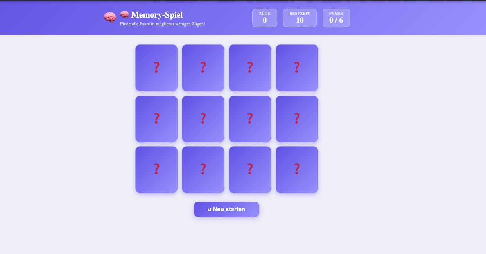

# 🧠 Hafıza Oyunu / Memory Game



---

## 📌 Proje Hakkında / About

**TR:** 4×3 matris üzerinde çalışan bir kart eşleştirme hafıza oyunu. 12 kartın (6 çift) hepsini eşleştirerek oyunu bitirin. En az hamlede bitirirseniz en iyi skorunuz localStorage'a kaydedilir.

**EN:** A card-matching memory game on a 4×3 grid. Flip cards two at a time — matched pairs disappear, mismatches flip back. Finish in the fewest moves to beat your best score, which is saved to localStorage.

---

## 🎮 Nasıl Oynanır / How to Play

1. Karta tıklayarak çevir / Click a card to flip it
2. İkinci kartı seç / Pick a second card
3. Eşleşirlerse kaybolur, eşleşmezlerse kapanır / Match → gone, no match → flips back
4. Tüm 6 çifti bul / Find all 6 pairs to win
5. **Restart** ile kartları karıştır ve yeniden başla / Hit **Restart** to shuffle and play again

---

## ✨ Özellikler / Features

- 🃏 **CSS 3D Flip** — `rotateY(180deg)` ile kart çevirme animasyonu
- ✅ **Eşleşme Tespiti** — `pairId` karşılaştırması ile anlık kontrol
- ⏱ **Hamle Sayacı** — her iki kart seçiminde `moves` +1 artar
- 🏆 **En İyi Skor** — oyun bitiminde düşük skor `localStorage`'a yazılır
- 🌟 **Yeni Rekor** — kazanma ekranında "Yeni rekor!" bildirimi
- 🔀 **Rastgele Karıştırma** — Fisher-Yates algoritması ile her restart'ta farklı sıra
- 📱 **Responsive** — mobil/tablet/masaüstü desteği
- 🌐 **Çok Dilli** — Türkçe, İngilizce, Almanca

---

## 🗂 Dosya Yapısı / File Structure

```
src/apps/memory/
├── MemoryGame.tsx          # Ana bileşen — board, stats, win banner, restart
├── MemoryGame.module.css   # Sayfa stilleri
├── types.ts                # CardType arayüzü (TypeScript)
├── hooks/
│   └── useMemoryGame.ts    # Oyun mantığı — shuffle, flip, match, score
└── components/
    ├── Card.tsx            # Tek kart — 3D flip animasyonu, matched fade-out
    └── Card.module.css
```

---

## 🧩 Teknik Detaylar / Technical Notes

| Konu                     | Detay                                                            |
| ------------------------ | ---------------------------------------------------------------- |
| Kart karıştırma          | Fisher-Yates in-place shuffle                                    |
| Eşleşme kontrolü         | `pairId` alanı karşılaştırması                                   |
| Yanlış eşleşme gecikmesi | 900ms `setTimeout` sonra kapatma                                 |
| Skor kaydı               | `localStorage` anahtarı: `memory_best_score`                     |
| Animasyon                | CSS `transform: rotateY(180deg)` + `transition: transform 0.45s` |
| Erişilebilirlik          | `role="button"`, `aria-pressed`, klavye `Enter` desteği          |

---

## 🛠 Teknolojiler / Tech Stack

- React 18 + TypeScript
- CSS Modules (3D flip, shimmer, responsive grid)
- react-i18next (TR / EN / DE)
- localStorage (best score kalıcılığı)
