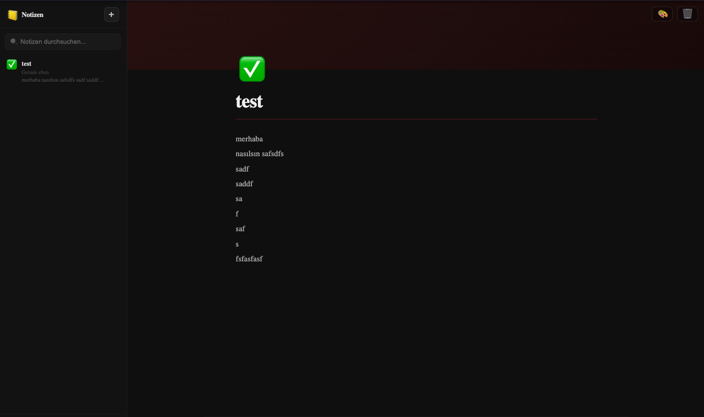

# 📒 Not Tutma Uygulaması

Notion benzeri arayüzüyle not oluşturma, düzenleme, silme ve sabitleme özelliklerine sahip; notları localStorage'da kalıcı olarak saklayan React uygulaması.



---

## Özellikler

| Özellik          | Açıklama                                                                                  |
| ---------------- | ----------------------------------------------------------------------------------------- |
| 📝 Not Oluşturma | Tek tıkla yeni not oluştur, başlık ve içerik gir                                          |
| ✏️ Not Düzenleme | Başlık ve içerik doğrudan sayfada düzenlenir; her değişiklik anında kaydedilir            |
| 🗑 Not Silme     | Üzerine gelindiğinde silme butonu belirir; yanlışlıkla silmeye karşı 2 tıklı onay sistemi |
| 📌 Sabitleme     | Notlar sabitlenebilir; sabitlenmiş notlar kenarda ayrı bölümde listelenir                 |
| 🎨 8 Renk Teması | Her nota farklı renk atanabilir (default, red, orange, yellow, green, blue, purple, pink) |
| 😀 Emoji İkonu   | 36 emoji arasından nota ikon seçilebilir                                                  |
| 🔍 Arama         | Başlık ve içerikte gerçek zamanlı arama                                                   |
| ⏱ Göreceli Zaman | "Az önce", "5 dk önce", "Dün" gibi göreceli güncelleme zamanı                             |
| 📊 İstatistik    | Editörün altında kelime sayısı, karakter sayısı ve son kayıt saati                        |
| 💾 localStorage  | Tüm notlar `notes_v1` anahtarıyla saklanır; tarayıcı kapansa da veriler korunur           |
| 🌍 Çok Dil       | Türkçe, İngilizce ve Almanca desteği                                                      |
| 📱 Responsive    | Mobilde kenar çubuğu ☰ butonu ile açılır/kapanır                                         |

---

## Kullanılan Teknolojiler

| Teknoloji     | Versiyon | Kullanım Amacı                     |
| ------------- | -------- | ---------------------------------- |
| React         | 18       | UI                                 |
| TypeScript    | 4+       | Tip güvenliği                      |
| React Router  | 7        | İç içe route yapısı (`/notes/:id`) |
| React Context | —        | Global not state yönetimi          |
| react-i18next | 14       | TR / EN / DE çeviri                |
| CSS Modules   | —        | Bileşen bazlı stil izolasyonu      |

---

## URL Yapısı

| Yol          | Sayfa                             |
| ------------ | --------------------------------- |
| `/notes`     | Boş durum ekranı (not seçilmemiş) |
| `/notes/:id` | Seçilen notun düzenleyici sayfası |

---

## localStorage

| Anahtar    | İçerik                            |
| ---------- | --------------------------------- |
| `notes_v1` | Tüm notlar JSON dizisi (`Note[]`) |

---

## Dosya Yapısı

```
notes/
├── NotesApp.tsx                  # Ana bileşen — layout, sidebar, nested Routes
├── NotesApp.module.css
├── types.ts                      # Note interface, NoteColor, NOTE_COLORS, EMOJI_LIST
├── contexts/
│   └── NotesContext.tsx          # CRUD (create/update/delete/togglePin), localStorage sync, useNotes() hook
└── components/
    ├── NotesSidebar.tsx           # Not listesi, arama, sabitlenmiş bölümü, pin/sil butonları
    ├── NotesSidebar.module.css
    ├── NoteEditor.tsx             # Cover bandı, emoji seçici, renk seçici, başlık, içerik, istatistik
    └── NoteEditor.module.css
```
