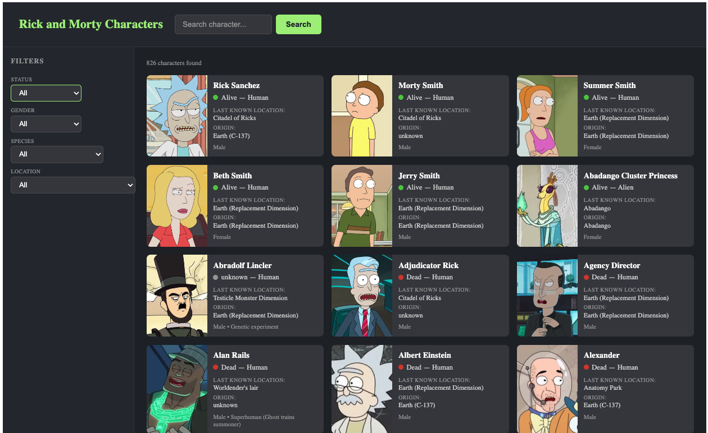

# 🧪 Rick and Morty Characters

Rick and Morty API'nin GraphQL backend'ini kullanarak karakterleri listeleyen, arayan ve filtreleyen React uygulaması.



> _Ekran görüntüsünü `docs/rickmorty-preview.png` yoluna ekleyebilirsin._

---

## Canlı API

```
https://rickandmortyapi.com/graphql
```

---

## Özellikler

| Özellik             | Açıklama                                             |
| ------------------- | ---------------------------------------------------- |
| 📋 Karakter listesi | Tüm karakterler fotoğraflarıyla grid'de listelenir   |
| 🔍 Arama            | İsme göre anlık karakter arama                       |
| 🎛️ Filtreler        | Status, Gender, Species ve Location bazlı filtreleme |
| 🧹 Filtre temizleme | Aktif filtreler tek tıkla sıfırlanır                 |
| 📄 Sayfalama        | Ellipsis'li sayfalama, toplam 42+ sayfa              |

---

## Kullanılan Teknolojiler

| Teknoloji     | Versiyon |
| ------------- | -------- |
| React         | 18       |
| TypeScript    | 4+       |
| Apollo Client | 4        |
| GraphQL       | 16       |
| CSS Modules   | —        |

---

## Dosya Yapısı

```
rickandmorty/
├── RickAndMortyApp.tsx         # Ana bileşen + Apollo Client setup
├── types/
│   └── index.ts                # Character, Filter, PageInfo tipleri
├── graphql/
│   └── queries.ts              # GET_CHARACTERS, GET_LOCATIONS sorguları
├── contexts/
│   └── RickMortyContext.tsx    # page, search, filter global state
└── components/
    ├── CharacterCard.tsx       # Tek karakter kartı (fotoğraf, status, location)
    ├── CharacterList.tsx       # Grid + loading / error / empty state
    ├── SearchBar.tsx           # İsme göre arama input'u
    ├── Filters.tsx             # Status / Gender / Species / Location seçicileri
    └── Pagination.tsx          # Sayfalama kontrolü
```

---

## GraphQL Query Örneği

```graphql
query GetCharacters($page: Int, $filter: FilterCharacter) {
  characters(page: $page, filter: $filter) {
    info {
      count
      pages
    }
    results {
      id
      name
      status
      species
      gender
      image
      location {
        name
      }
      origin {
        name
      }
    }
  }
}
```

---

## Ekran Görüntüsü

> `docs/rickmorty-preview.png` yoluna ekran görüntüsünü ekleyebilirsin.
