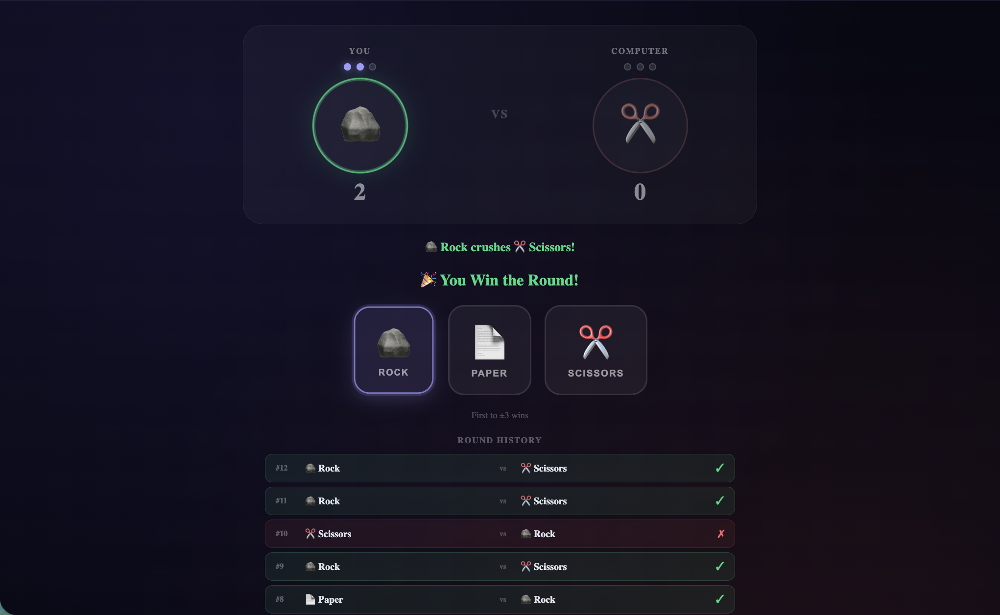

# ✊ Rock Paper Scissors

A modern, animated Rock–Paper–Scissors game with a **rival arena** layout, phase-based state machine and rich CSS keyframe animations.



---

## Features

| Feature                 | Details                                                                              |
| ----------------------- | ------------------------------------------------------------------------------------ |
| **Rival arena layout**  | Player (left) vs Computer (right) with fighter names and pip score indicators        |
| **Phase state machine** | `idle → thinking → result` — each transition triggers matching animations            |
| **Thinking indicator**  | Computer shows animated typing dots for 850 ms before revealing its pick             |
| **3D flip reveal**      | Computer's choice flips in with a CSS `perspective` Y-rotation animation             |
| **Player bounce-in**    | Player's choice slides in from the left with a spring overshoot curve                |
| **Winner / Loser FX**   | Winner bubble gets a green pulse glow; loser bubble shakes and desaturates           |
| **Battle FX emoji**     | A 💥 / 💀 / 🤝 icon pops in the VS centre on every round result                      |
| **Combat description**  | Slides up describing what beat what ("🪨 Rock crushes ✂️ Scissors!")                 |
| **Score pips**          | Animated pip circles fill up as rounds are won (3 pips per side)                     |
| **Per-button hover**    | Rock shakes, scissors snips, paper waves on hover — each button has its own keyframe |
| **Game over overlay**   | Frosted glass overlay with a trophy / skull + bounce-in card and Play Again button   |
| **Round history**       | Full scrollable list of past rounds with win/lose/draw colour coding                 |
| **First to ±3 wins**    | Win a round → +1, lose → -1. First to reach ±3 ends the game                         |
| **i18n (TR / EN / DE)** | All strings fully translated via react-i18next                                       |

---

## How to play

1. Navigate to `/rps`
2. Click **Rock**, **Paper** or **Scissors**
3. The computer "thinks" for a moment, then its choice flips in
4. Watch the arena react — winner glows, loser shakes
5. First side to earn **3 points** wins the match

---

## Tech stack

- **React 18** with functional components and hooks
- **TypeScript** — strict mode, zero `any`
- **CSS Modules** — all styles scoped, zero className collisions
- **react-i18next** — TR / EN / DE translations

---

## Component structure

```
RpsApp.tsx          — main game component
RpsApp.module.css   — all styles and keyframe animations
```

### State

| State variable   | Type                               | Purpose                                                           |
| ---------------- | ---------------------------------- | ----------------------------------------------------------------- |
| `phase`          | `"idle" \| "thinking" \| "result"` | Controls which animations are active                              |
| `playerChoice`   | `Choice \| null`                   | Player's current selection                                        |
| `computerChoice` | `Choice \| null`                   | Computer's revealed pick                                          |
| `currentResult`  | `RoundResult \| null`              | `"win" \| "lose" \| "draw"`                                       |
| `score`          | `number`                           | Net score (`+` = player leading, `−` = computer leading)          |
| `rounds`         | `Round[]`                          | Round history array                                               |
| `gameOver`       | `"player" \| "computer" \| null`   | Who won the match                                                 |
| `roundKey`       | `number`                           | Incremented each round to force animation re-mount via `key` prop |

### Animations (keyframes)

| Name                                         | Trigger                           | Effect                                |
| -------------------------------------------- | --------------------------------- | ------------------------------------- |
| `playerSlideIn`                              | Player bubble has choice          | Spring bounce from left with rotation |
| `flipReveal`                                 | Computer bubble gains `.revealed` | 3D Y-axis perspective flip            |
| `winnerGlow`                                 | `.bubbleWinner`                   | Pulsing green box-shadow              |
| `loserShake`                                 | `.bubbleLoser`                    | Horizontal shake + desaturate         |
| `thinkingPulse`                              | `.bubbleThinking`                 | Border-colour glow cycle              |
| `dotBounce`                                  | Each `.dot`                       | Staggered chat-style typing dots      |
| `vsFlash`                                    | `.vsFlash` on result              | VS label scales up and blazes white   |
| `battlePop`                                  | `.battleFx`                       | Emoji scales 0 → 1.5 → 0              |
| `slideUp`                                    | `.combatDesc`                     | Description slides up from bottom     |
| `pipFill`                                    | `.pipPlayer` / `.pipComp`         | Bouncy pip circle fill                |
| `histSlide`                                  | `.histRow`                        | History row slides in from left       |
| `gameOverPop`                                | `.gameOverCard`                   | Overlay card bounces in               |
| `rockHover` / `paperHover` / `scissorsHover` | Button hover                      | Per-choice personality hover          |

---

## i18n keys

All keys live under the `"rps"` namespace.

| Key                       | EN                                          |
| ------------------------- | ------------------------------------------- |
| `rps.title`               | Rock Paper Scissors                         |
| `rps.subtitle`            | Play against the computer, first to 3 wins! |
| `rps.you`                 | You                                         |
| `rps.computer`            | Computer                                    |
| `rps.rock`                | Rock                                        |
| `rps.paper`               | Paper                                       |
| `rps.scissors`            | Scissors                                    |
| `rps.round_win`           | 🎉 You Win the Round!                       |
| `rps.round_lose`          | 😔 You Lose the Round!                      |
| `rps.round_draw`          | 🤝 Draw!                                    |
| `rps.you_win`             | 🏆 You Win!                                 |
| `rps.computer_wins`       | 💥 Computer Wins!                           |
| `rps.play_again`          | Play Again                                  |
| `rps.history`             | Round History                               |
| `rps.hint`                | First to ±{{score}} wins                    |
| `rps.desc_rock_scissors`  | 🪨 Rock crushes ✂️ Scissors!                |
| `rps.desc_scissors_paper` | ✂️ Scissors cuts 📄 Paper!                  |
| `rps.desc_paper_rock`     | 📄 Paper wraps 🪨 Rock!                     |
| `rps.desc_draw`           | 🤝 Draw! No points scored.                  |
