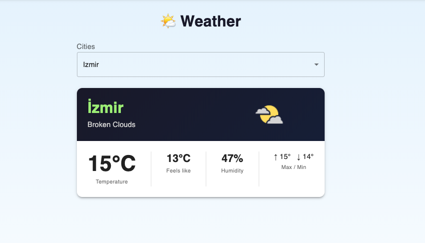

# 🌤 Weather App

OpenWeatherMap API kullanarak Türkiye şehirlerine ait anlık hava durumu bilgilerini görüntüleyen React uygulaması.



---

## Özellikler

- Türkiye'deki tüm **81 şehir** arasından seçim yapılabilir
- Seçilen şehir için **anlık hava durumu** bilgisi gösterilir
- Hava durumuna uygun **ikon** görüntülenir (güneşli, bulutlu, yağmurlu, karlı…)
- Hissedilen sıcaklık ve nem bilgisi
- Yükleme ve hata durumları için ayrı görünümler

---

## Kullanılan Teknolojiler

| Teknoloji          | Versiyon |
| ------------------ | -------- |
| React              | 18       |
| TypeScript         | 4+       |
| MUI (Material UI)  | 5        |
| OpenWeatherMap API | 2.5      |

---

## Kurulum

Projenin kök dizininde `.env` dosyası oluştur ve API anahtarını ekle:

```env
REACT_APP_WEATHER_API_KEY=your_api_key_here
```

> API anahtarını edinmek için: [openweathermap.org](https://openweathermap.org/api)

---

## Dosya Yapısı

```
weatherapp/
├── WeatherApp.tsx              # Ana bileşen
├── components/
│   ├── Header.tsx              # Şehir seçici dropdown
│   ├── Weathers.tsx            # Hava bilgisi kartı
│   └── SelectWeatherImg.tsx    # Duruma göre ikon seçici
├── contexts/
│   └── WeatherContext.tsx      # API çağrısı + global state
└── assets/                     # Hava durumu ikonları (.png)
```
